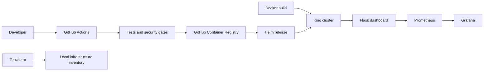

# Local DevSecOps Capstone

A zero-cost, end-to-end DevSecOps platform for a Flask status dashboard. It combines GitHub Actions, Docker, Kind, Helm, Terraform, Prometheus, Grafana, Pytest, Semgrep, Trivy, Checkov, and Kubescape. This project is derived from [Dibyasha Sahu's kubernetes-devsecops-pipeline](https://github.com/Dibyasha-Sahu/kubernetes-devsecops-pipeline); the original author attribution and [license](LICENSE) are retained.

## Quick start (WSL 2 Ubuntu)

```bash
cd "/mnt/c/Users/Harsh/Documents/New project 2/devops-capstone"
bash setup.sh
bash start.sh
```

| Service | URL | Credentials |
|---|---|---|
| Application | http://localhost:8080 | none |
| Grafana | http://localhost:3000 | `admin` / `admin` |
| Prometheus | http://localhost:9090 | none |
| SonarQube (optional) | http://localhost:9000 | start with `docker compose --profile quality up -d` |

If a port is busy, copy `.env.example` to `.env` and change its port. Run `bash status.sh` for health and URLs.

## Daily commands

```bash
bash start.sh       # idempotent full start/build/deploy
bash status.sh      # Compose + Kubernetes health
bash demo.sh        # faculty demonstration menu
bash faculty-demo.sh # fully guided version-change faculty demo
bash restart.sh
bash stop.sh        # preserves the Kind cluster and data
bash cleanup.sh     # confirmation-gated project-only removal
```

## Architecture



The application endpoints are `/`, `/health`, `/ready`, `/metrics`, and `/api/status`. The container runs as UID 10001. Kubernetes uses resource requests/limits, liveness/readiness probes, rolling updates, a read-only filesystem, dropped capabilities, RuntimeDefault seccomp, two replicas, and HPA from two to five replicas.

## Verification

```bash
.venv/bin/pytest -q app/tests
docker build -t devops-capstone:local .
helm lint helm/devsecops-app
helm template devops-capstone helm/devsecops-app > reports/rendered-helm.yaml
terraform -chdir=terraform fmt -check
terraform -chdir=terraform validate
.venv/bin/semgrep --config .semgrep.yml app
```

CI publishes only `main` push images to GHCR using `GITHUB_TOKEN`; no credentials are hardcoded. GitHub-hosted CD validates deployment in its own ephemeral Kind cluster. Local deployment remains a deliberate local script because hosted runners cannot reach this computer.

See [docs/project-report.md](docs/project-report.md), [docs/installation.md](docs/installation.md), [docs/security-monitoring.md](docs/security-monitoring.md), [docs/evaluation-rubric.md](docs/evaluation-rubric.md), and [docs/faculty-demo.md](docs/faculty-demo.md).
