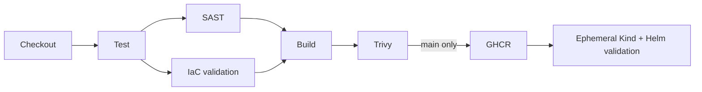

# CI/CD Workflow

The workflow grants read-only repository access plus package write permission. GHCR authentication uses the ephemeral `GITHUB_TOKEN`; no local cluster access or static secret is assumed.
