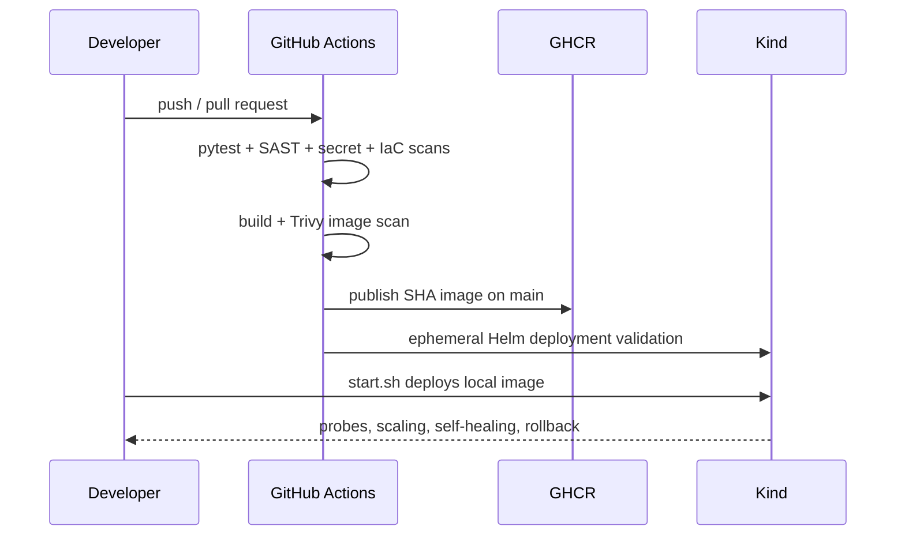

# Project Report

## Problem statement and objectives

Software teams need repeatable delivery without sacrificing security or visibility. This capstone builds a local, zero-cost delivery platform that tests, scans, packages, deploys, observes, scales, and recovers a small web application. The priorities are a two-command setup, evidence-based demonstration, low resource use, and clean separation between Compose monitoring, Helm-managed workloads, and Terraform-managed inventory.

## Toolchain design

Git/GitHub provide history; GitHub Actions orchestrates CI/CD; Pytest verifies behavior; Semgrep and Gitleaks inspect source; Trivy inspects images and configuration; Docker creates an immutable runtime; Kind supplies Kubernetes; Helm owns application resources; Terraform generates a reproducible local infrastructure inventory; Prometheus scrapes real application metrics; Grafana visualizes them. SonarQube is an optional Compose profile because it is resource intensive.

## Responsibilities for five students

1. Application and automated tests.
2. Docker, supply-chain security, and GitHub Actions.
3. Kubernetes, Kind, Helm, HPA, and reliability demos.
4. Terraform and lifecycle automation.
5. Prometheus, Grafana, reports, and presentation documentation.

## Original attribution

Foundation: `Dibyasha-Sahu/kubernetes-devsecops-pipeline`, authored by Dibyasha Sahu. The upstream LICENSE remains unchanged. Additions in this capstone include the dashboard UI/API, portable lifecycle automation, local Compose stack, provisioned Grafana dashboard, HPA, demonstration flow, and consolidated documentation.
